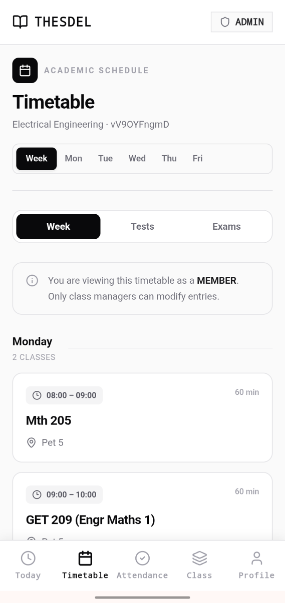
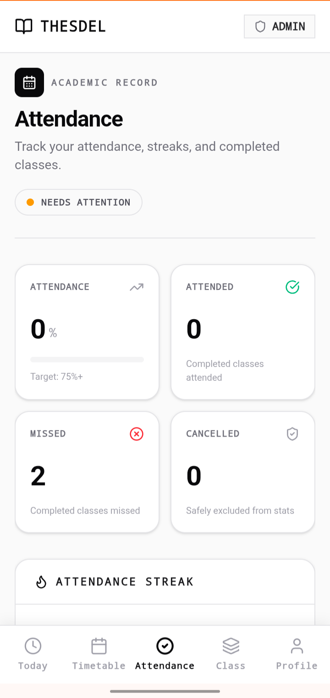
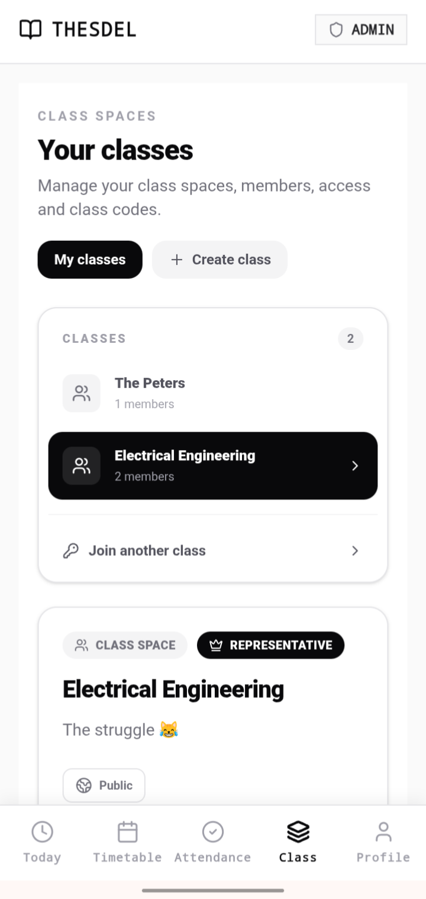

# Thesdel - Student Timetable Infrastructure

> **Engineering Note:** The source code for Thesdel is kept private to protect proprietary business logic. This repository serves as a public technical overview, architectural case study, and UI showcase.

## Overview
Thesdel is a full-stack web application designed to solve the problem of fragmented and static timetables for university students. Built specifically for the unique scheduling challenges at Obafemi Awolowo University (OAU), it allows students to dynamically view, manage, and track their academic schedules.

**Live Application:** [https://thesdel.com](https://thesdel.com)

## Tech Stack
*   **Frontend:** React, TypeScript
*   **Backend:** Go (Golang)
*   **Database & Auth:** Supabase (PostgreSQL)
*   **Hosting/Infrastructure:** Vercel, Cloudflare

## Architecture & Technical Decisions

### 1. Unified UI with Role-Based Access Control (RBAC)
Instead of building separate dashboards for Admins, Class Representatives, and Students, Thesdel uses a single, unified interface. The UI dynamically adapts based on the user's role in the database. This significantly reduces frontend code duplication and provides a smoother experience, as a Class Rep is also a student who needs to see their own timetable.

### 2. Why Go for the Backend?
Go was chosen to handle concurrent requests efficiently during peak traffic times, specifically when students are checking schedules right before a new semester. Go's strong typing and standard library provided a robust foundation for the API without the overhead of heavier frameworks.

### 3. Why TypeScript on the Frontend?
Given the complex data structures involved in parsing course codes, time slots, and venues, TypeScript was non-negotiable. It prevented runtime errors related to date/time parsing and ensured the frontend communicated with the backend with strict type safety.

### 4. Infrastructure with Vercel and Cloudflare
The application leverages Vercel for reliable frontend deployment and Cloudflare for DNS, caching, and security, ensuring the app remains fast and accessible even on restricted mobile networks.

## Key Features
*   **Dynamic Timetable Generation:** Users input registered courses and instantly generate a conflict-free schedule.
*   **Attendance Analytics:** Built-in tracking to monitor class attendance percentages, streaks, and missed classes against a strict 75% target.
*   **Class Spaces:** Multi-user environments allowing students to create or join class groups, with granular permissions for Admins, Class Reps, and Members to manage entries.

## Engineering Challenges Solved
*   **Challenge:** Handling authentication flows and ensuring user data remained secure.
    *   **Solution:** Integrated Supabase Auth. This required configuring OAuth consent screens and correctly handling session tokens on the client side to protect user data.
*   **Challenge:** Managing complex state for timetable rendering.
    *   **Solution:** Utilized strict TypeScript interfaces to define the shape of course data, preventing the UI from crashing when handling irregular time slots or missing venue data.

## Interface Showcase

**Timetable Architecture**

**Attendance Tracking Logic**

**Class Spaces and RBAC Management**

## Author
**Jonathan Peter**
*   Computer Engineering Student @ OAU
*   [LinkedIn](https://www.linkedin.com/in/jonathan-peter-48a1ab383)
*   [Portfolio](https://thesdel.com/litheral)
